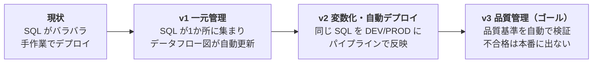
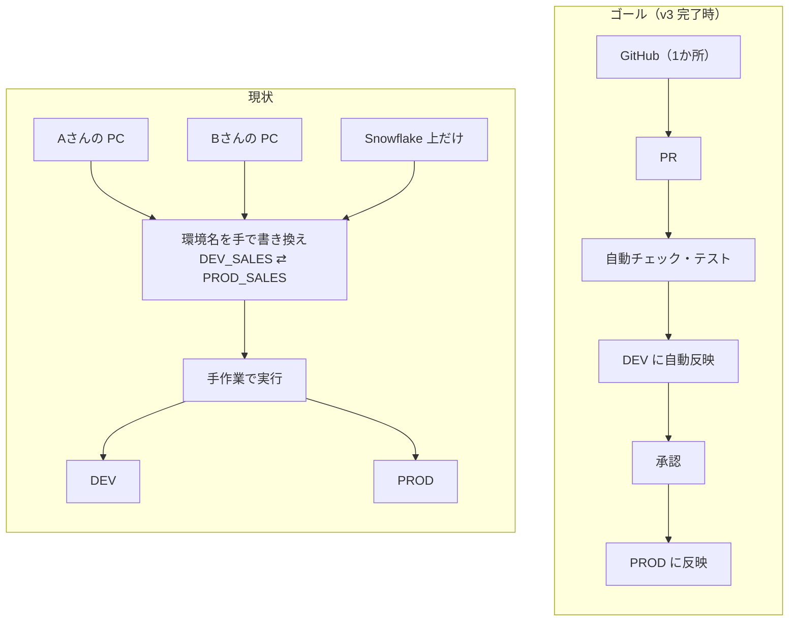
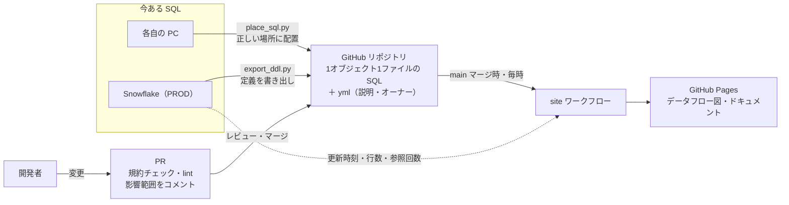
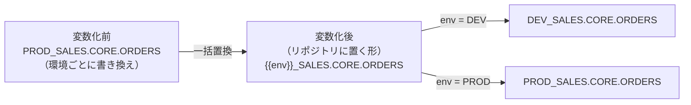
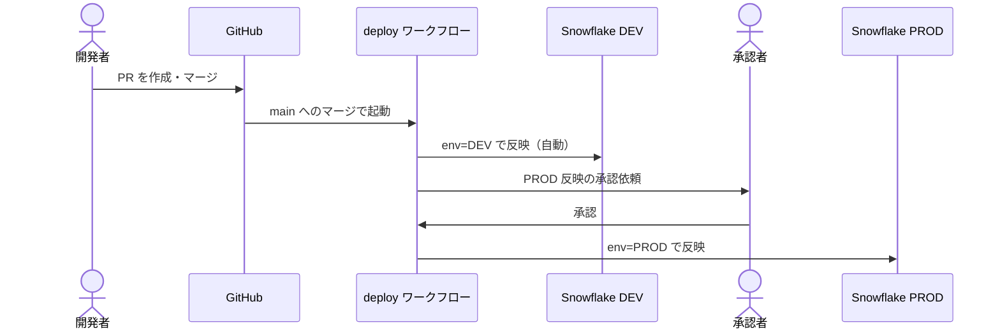
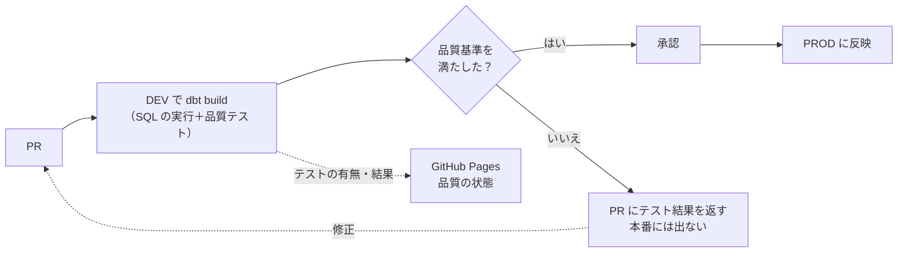

# ロードマップ

Snowflake の SQL を「誰も管理していない状態」から「品質まで管理できている状態」へ、3つのバージョンに分けて移行します。
v3 の完了をこの取り組みのゴールとします。

## なぜやるのか（現状とゴール）

a

| 課題 | 起きていること |
|---|---|
| SQL がバラバラ | 各自の PC と Snowflake 上に散らばっていて、どれが最新か・誰が持っているか分からない |
| DB 名が直書き | `DEV_SALES` / `PROD_SALES` のように環境名が SQL に書かれていて、環境ごとに書き換えて流している |
| デプロイが手作業 | 本番への反映を人が手で実行していて、反映漏れ・ミスに気づきにくい |
| 品質が見えない | データの流れや、データが正しいかを確かめる仕組みが無い |

## 全体像

バージョンごとに何が変わるか：

| | 現状 | v1 | v2 | v3 |
|---|---|---|---|---|
| **SQL の置き場所** | 各自の PC・Snowflake | GitHub に集約 | GitHub | GitHub |
| **DB 名** | 直書き | 直書き（PROD 基準） | `{{ env }}_SALES` で変数化 | 変数化 |
| **デプロイ** | 手作業 | 手作業（PR で事前レビュー） | パイプライン（DEV 自動・PROD 承認） | パイプライン＋テスト合格が条件 |
| **品質の確認** | なし | 規約チェック・lint・影響範囲 | ＋環境名の直書き検出 | ＋データの品質テスト（dbt） |
| **ドキュメント・データフロー** | なし | Pages で自動更新 | Pages（論理名で表示） | Pages＋品質の状態 |

| バージョン | 状態 |
|---|---|
| v1 | 仕組みはサンプルで実装済み。本番データの取り込みはこれから |
| v2 | 未着手 |
| v3 | 未着手 |

各バージョンは前のバージョンの完了を前提にしています。

---

## v1：一元管理と自動ドキュメント

**目的**：すべての SQL を1つの GitHub リポジトリに集め、変更は PR を通す。データフローとドキュメントを誰でも見られるようにする。

### やること
1. 本番（PROD）の既存オブジェクトを `tools/export_ddl.py` で `sql/<DB>/<SCHEMA>/<種別>/<NAME>.sql` に書き出す
2. 各自の PC にある SQL を `tools/place_sql.py` で正しい場所に配置し、Snowflake の定義との違いを確認して PR にする
3. オブジェクトごとの yml に説明・オーナー・タグを書く（`tools/schemas/object.schema.json` の必須項目）
4. GitHub の設定：CODEOWNERS のレビュー担当、main のブランチ保護（PR と `pr` ワークフローの成功を必須に）
5. GitHub Pages を有効にし、`site` ワークフローでデータフロー図とドキュメントを自動公開する

DB 名はこの時点ではハードコードのまま（PROD の名前）で取り込みます。変数化は v2 で行います。

### 成果物
- `sql/` 配下の全オブジェクトの SQL と yml
- GitHub Pages のデータフローマップ（テーブル・カラムのリネージ、説明、最終更新・参照回数）
- `pr` ワークフロー：規約チェック、sqlfluff、SQL が解析できるか、変更の影響範囲（下流のテーブル・削除カラムの利用先）を PR にコメント

### 完了の条件
- 本番のオブジェクトがすべてリポジトリにある
- Pages が自動で更新されている
- main への変更は PR 経由のみ（直接 push できない）

### このバージョンから守るルール
- SQL を変えるときは、先にリポジトリを変えて PR を出す
- 新しいオブジェクトには yml（説明・オーナー）を必ず付ける

### 事前に決めること
- 対象にする DB とスキーマ（`config.yml`）
- 各 DB・スキーマのレビュー担当（`.github/CODEOWNERS`）
- Snowflake の読み取り用サービスユーザーと権限（README の「導入手順」）

---

## v2：環境の変数化とデプロイ自動化

**目的**：SQL から環境名の直書きをなくし、同じ SQL を DEV / PROD に出し分ける。そのうえで、本番への反映をパイプラインに任せる。

デプロイ自動化を v2 に入れるのは、変数化しないと1つの SQL を DEV と PROD に出し分けられず、自動化できないためです。

**変数化**：1つの SQL から、環境ごとの SQL を作り出します。

**デプロイの流れ**：マージすると DEV に自動で反映され、承認すると PROD に反映されます。

### やること
1. DB 名を変数に置き換える：`PROD_SALES` → `{{ env }}_SALES`（`env` に `DEV` / `PROD` が入る）
   - 一括置換スクリプトを用意し、スキーマ単位で PR にする
2. 環境名の直書きを PR チェックで検出し、新しく混ざらないようにする
3. データフロー図は論理名（`SALES` など）で表示する
4. デプロイのパイプラインを作る（schemachange か Snowflake CLI。v2 の最初に選定）。PROD の承認は GitHub Environments を使う
5. デプロイ用のサービスユーザーを作り、人のロールから本番の DDL 権限を外す

### 成果物
- 変数化された `sql/`、置換スクリプト、直書き検出のチェック
- `deploy` ワークフロー（DEV 自動・PROD 承認付き）

### 完了の条件
- SQL に環境名の直書きが無い（CI で検出できている）
- 本番の DDL はパイプライン経由でしか実行できない

### このバージョンから守るルール
- Snowflake の画面から本番のオブジェクトを直接作成・変更しない
- DB 名は必ず `{{ env }}_xxx` の形で書く

### 事前に決めること
- デプロイツール（schemachange か Snowflake CLI）
- PROD デプロイの承認者
- DEV / PROD 以外の環境（STG など）を使うか

---

## v3：データ品質管理

**目的**：「正しいデータ」とは何かを基準として定義し、変更のたびに自動で検証する。基準を満たさない変更は本番に出さない。品質の状態を誰でも見られるようにする。

品質の基準（テーブルごとに yml の `tests` に書く）：

| 基準 | 意味 | 例 |
|---|---|---|
| 一意（unique） | 主キーが重複しない | 注文 ID が1注文に1つ |
| 必須（not_null） | 必須の項目が空でない | 注文日が必ず入っている |
| 参照整合（relationships） | テーブル間の参照が切れていない | 注文の顧客 ID が顧客マスタにある |
| 区分値（accepted_values） | 値が決められた範囲・区分に収まる | ステータスが決めた値のどれか |

### やること
1. **品質の基準を決める**：上の表の基準を、主要テーブルから yml の `tests` に定義する
2. **基準を自動で検証する**：変換系の SQL（CTAS / INSERT / MERGE / VIEW）を dbt に移し、PR とデプロイのたびに DEV で `dbt build` を走らせる。テストが失敗した変更は PROD に出さない
3. **品質の状態を見える化する**：テストの有無と直近の結果を Pages のオブジェクト詳細に表示し、テストが設定されていないテーブルを一覧にする。データフロー図は dbt の情報（manifest）も取り込んで1つにまとめる

**なぜ dbt を使うか**：品質の基準（テスト）の定義、その実行、テーブル間の依存関係、ドキュメントを1つの仕組みで扱えるためです。dbt は品質管理を実現するための手段で、目的は品質の基準を決めて守ることです。v1 から yml の `tests` に基準を書けるようにしてあるので、not_null・unique などはそのまま dbt のテストとして使えます（参照整合のように引数が要るテストは、v3 で yml の書き方を拡張します）。

### 成果物
- 主要テーブルの品質基準（yml の `tests`）
- dbt プロジェクト（変換系 SQL）と、PR・デプロイ時のテスト実行
- Pages の品質表示（テストの有無・結果、テスト未設定の一覧）

### 完了の条件（＝この取り組みのゴール）
- 主要テーブルに品質基準が定義されている
- PR とデプロイで自動検証され、基準を満たさない変更は本番に出ない
- 品質の状態が Pages で見える

### このバージョンから守るルール
- 新しいテーブルを作るときは、主キーと必須項目のテストを必ず付ける
- テストを外す・緩めるときは、理由を PR に書く

### 事前に決めること
- 「主要テーブル」の範囲（どこからテストを付けるか）
- dbt の実行環境（dbt Core を GitHub Actions で動かすか、dbt Cloud を使うか）

---

## ゴールの姿（v3 完了時）

冒頭の「[なぜやるのか](#なぜやるのか現状とゴール)」の図の右側が、v3 完了時の流れです。

- SQL はすべて1つの GitHub リポジトリにあり、どれが最新か迷わない
- SQL の追加・変更は「PR → 自動チェック・テスト → DEV → 承認 → PROD」の一本道だけ
- 環境ごとの書き換えや、手作業のデプロイが無い
- データの流れ・説明・品質の状態を、Pages で誰でも確認できる
- 品質基準を満たさない変更は本番に出ない

## 現在地

v1 の仕組み（`tools/`・`site/`・`.github/workflows/`）はサンプルデータで実装・動作確認済みです。
次は、本番オブジェクトの書き出し（v1 の「やること」の1）から始めます。
